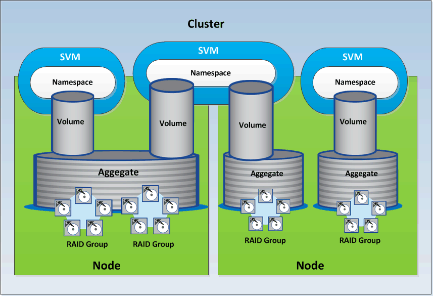

= 了解 Active IQ Unified Manager 中的 ONTAP 儲存設備資源模型
:allow-uri-read: 
:icons: font
:imagesdir: ../media/

[role="lead"]
ONTAP 中的儲存資源可以大致分為 _實體儲存設備資源_ 和 _邏輯儲存資源_。若要使用 Active IQ Unified Manager 中提供的 API 有效管理 ONTAP 系統，您必須了解儲存資源模型以及各種儲存資源之間的關係。

* *實體儲存資源*
+
指 ONTAP 提供的實體儲存設備物件。實體儲存資源包括磁碟、叢集、儲存設備控制器、節點和彙總。

* *邏輯儲存資源*
+
指的是 ONTAP 提供的、不與實體資源綁定的儲存資源。這些資源與儲存虛擬機器（SVM，以前稱為 Vserver）相關聯，並且獨立於任何特定的實體儲存設備資源（例如磁碟、陣列 LUN 或彙總）而存在。

+
邏輯儲存資源包括各種類型的 Volume 和 qtree，以及您可與這些資源搭配使用的功能和組態，例如 Snapshot 快照技術複本、重複資料刪除、壓縮和配額。

下圖顯示 2 節點叢集中的儲存資源：

