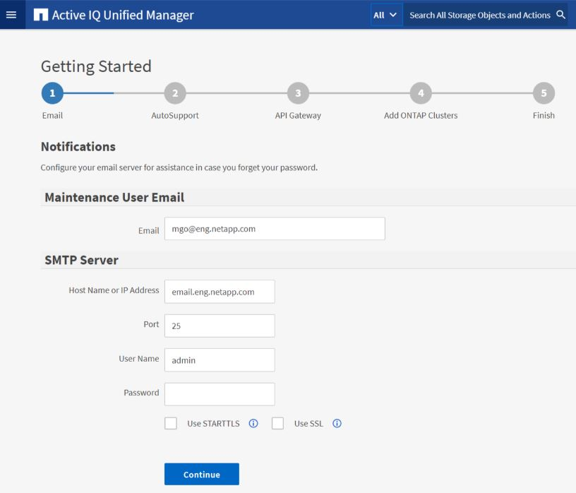

= 執行 Active IQ Unified Manager Web UI 的初始設定
:allow-uri-read: 
:icons: font
:imagesdir: ../media/

[role="lead"]
若要使用 Unified Manager，您必須先設定初始設定選項，包括 NTP 伺服器、維護使用者電子郵件地址、SMTP 伺服器主機，以及新增 ONTAP 叢集。

.開始之前
您必須已執行下列操作：

* 使用安裝後提供的 URL 啟動 Unified Manager Web UI
* 使用安裝期間建立的維護使用者名稱和密碼（Linux 安裝為 umadmin 使用者）登入

Active IQ Unified ManagerGetting Started 頁面僅在您首次存取 Web 使用者介面時顯示。以下頁面來自 VMware 上的安裝。

如果您稍後想要變更任何這些選項，可以從 Unified Manager 左側導覽窗格的「一般」選項中進行選擇。請注意，NTP 設定僅適用於 VMware 安裝，且稍後可使用 Unified Manager 維護主控台進行變更。

.步驟
. 在 Active IQ Unified Manager 的初始設定頁面中，輸入維護使用者的電子郵件地址、SMTP 伺服器主機名稱和任何其他 SMTP 選項，以及 NTP 伺服器（僅限 VMware 安裝）。然後按一下 *繼續*。
+
[NOTE]
====
如果您選擇了 *使用 STARTTLS* 或 *使用 SSL* 選項，按一下 *繼續* 按鈕後將顯示憑證頁面。請驗證憑證詳細資訊並接受憑證，以繼續進行 Web UI 的初始設定。

====
. 在 AutoSupport 頁面上，按一下 *同意並繼續* 以啟用從 Unified Manager 傳送 AutoSupport 訊息至 NetAppActive IQ。
+
如果您需要指定 Proxy 來提供網際網路存取以傳送 AutoSupport 內容，或者如果您想要停用 AutoSupport，請使用 Web UI 中的 *一般* > *AutoSupport* 選項。

. 在 Red Hat 系統中，將 umadmin 使用者密碼從預設的「`admin`」字串變更為個人化字串。
. 在「設定 API 閘道」頁面中，選擇是否要使用 API 閘道功能，該功能可讓 Unified Manager 管理您規劃使用 ONTAP REST API 監控的 ONTAP 叢集。然後按一下 *繼續*。
+
您稍後可以在 Web UI 中，從 *一般* > *功能設定* > *API 閘道* 啟用或停用此設定。如需 API 的詳細資訊，請參閱 link:../api-automation/concept_get_started_with_um_apis.html["Active IQ Unified Manager REST API 入門指南"]。

. 新增您希望 Unified Manager 管理的叢集，然後按一下 *下一步*。對於您計畫管理的每個叢集，您必須擁有主機名稱或叢集管理 IP 位址（IPv4 或 IPv6），以及使用者名稱和密碼憑證 - 該使用者必須具有 "`admin`" 角色。
+
此步驟為選用。您稍後可以在 Web 使用者介面中從 *儲存管理* > *叢集設定* 新增叢集。

. 在「摘要」頁面中，確認所有設定均正確，然後按一下 *完成*。

「入門指南」頁面關閉，並顯示「Unified Manager 儀表板」頁面。
