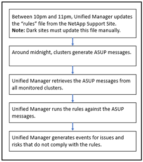

= Active IQ Unified Manager 如何產生 Active IQ 平台事件
:allow-uri-read: 
:icons: font
:imagesdir: ../media/

[role="lead"]
Active IQ 平台事件和風險會轉換為 Unified Manager 事件，如下圖所示。

如您所見， Active IQ 平台上編譯的規則檔案保持最新狀態，叢集 AutoSupport 訊息每天都會產生， Unified Manager 每天都會更新事件清單。
