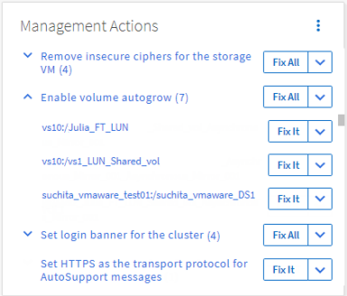

= 使用 Active IQ Unified Manager 中的自動修復功能來解決問題
:allow-uri-read: 
:icons: font
:imagesdir: ../media/

[role="lead"]
Unified Manager 可以對某些事件進行全面診斷，並透過 *Fix It* 按鈕提供單一解決方案。如有解決方案，則會顯示在儀表板、事件詳情頁面以及左側導覽功能表的「工作負載分析」選項中。

大多數事件都有多種可能的解決方案，這些方案會顯示在事件詳情頁面中，以便您可以使用 ONTAP System Manager 或 ONTAP CLI 實作最佳解決方案。當 Unified Manager 確定只有單一解決方案可以解決問題，並且可以使用 ONTAP CLI 命令解決該問題時，則會提供 *Fix It* 行動。

.步驟
. 若要檢視可從*儀表板*修復的事件，請點選*儀表板*。
+

. 若要解決 Unified Manager 可以修復的任何問題，請按一下 *Fix It* 按鈕。若要修復多個物件上存在的問題，請按一下 *Fix All* 按鈕。

有關可透過自動修復解決的問題資訊，請參閱link:..//storage-mgmt/reference_what_ontap_issues_can_unified_manager_fix.html["Unified Manager 可以解決哪些問題"]。
