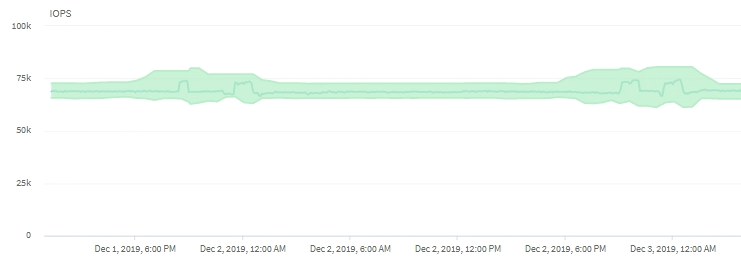

= 評估叢集操作如何影響 Active IQ Unified Manager 中的工作負載延遲
:allow-uri-read: 
:icons: font
:imagesdir: ../media/

[role="lead"]
作業（IOPS）代表叢集上所有使用者定義和系統定義的工作負載的活動。IOPS 統計資料可協助您判斷叢集程序（例如建立備份或執行重複資料刪除）是否會影響工作負載延遲（回應時間），或是否可能導致或促成效能事件。

分析效能事件時，您可以使用 IOPS 統計資料來判斷效能事件是否由叢集上的問題所引起。您可以識別可能是造成效能事件主因的特定工作負載活動。IOPS 的測量單位為每秒作業次數（ops/sec）。

此範例顯示 IOPS 圖表。實際作業統計資料以藍線表示，而作業統計資料的 IOPS 預測以綠色表示。

[NOTE]
====
在某些情況下，如果叢集過載， Unified Manager 可能會顯示此訊息 `Data collection is taking too long on Cluster _cluster_name_`。這意味著 Unified Manager 尚未收集到足夠的統計資料進行分析。您需要減少叢集使用的資源，以便收集統計資料。

====