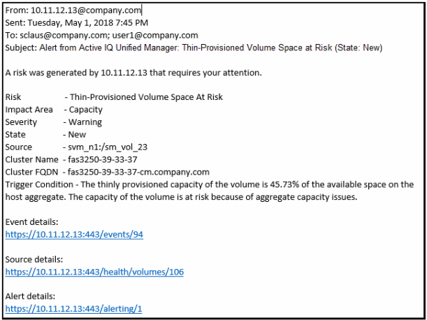

= 在 Active IQ Unified Manager 中檢閱警示電子郵件中的資訊
:allow-uri-read: 
:icons: font
:imagesdir: ../media/

[role="lead"]
Unified Manager 警示電子郵件會提供事件類型、事件嚴重程度、遭違反並導致事件的原則或臨界值名稱，以及事件的執行摘要。電子郵件訊息也會為每個事件提供超連結，讓您可以在 UI 中檢視該事件的詳細資料頁面。

系統會傳送提醒郵件給所有訂閱接收提醒的使用者。

如果在收集期間效能計數器或容量值發生大幅變化，可能會導致同一個臨界值原則同時觸發關鍵和警告事件。在這種情況下，您可能會收到一封警告事件的電子郵件和一封關鍵事件的電子郵件。這是因為 Unified Manager 允許您分別訂閱接收警告和關鍵臨界值超限的警報。

以下是一封範例警報郵件：

