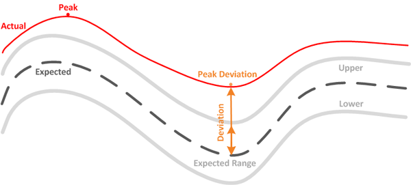

= 了解 Active IQ Unified Manager 中的工作負載效能測量值
:allow-uri-read: 
:icons: font
:imagesdir: ../media/

[role="lead"]
Unified Manager 根據歷史和預期統計值來測量叢集上工作負載的效能，這些統計值構成了工作負載的延遲預測值。它會將實際的工作負載統計值與延遲預測進行比較，以判斷工作負載效能何時過高或過低。未如預期運作的工作負載會觸發動態效能事件來通知您。

在下圖中，紅色實際值代表該時間段內的實際效能統計資料。此實際值已超過效能臨界值，即延遲預測的上限。峰值是該時間段內的最高實際值。偏差衡量預期值（預測值）與實際值之間的變化，而峰值偏差則表示預期值與實際值之間的最大變化。

下表列出工作負載效能測量值。

|===
| 測量 | 說明 

 a| 
活動
 a| 
原則群組中工作負載使用的 QoS 限制百分比。

[NOTE]
====
如果 Unified Manager 偵測到原則群組發生變更（例如新增或刪除 Volume 或變更 QoS 限制），則實際值和預期值可能超過設定限制的 100%。如果某個值超過設定限制的 100%，則顯示為 >100%。如果某個值小於設定限制的 1%，則顯示為 <1%。

====

 a| 
實際
 a| 
在特定時間對給定工作負載測得的效能值。

 a| 
偏差
 a| 
預期值與實際值之間的變化。這是實際值減去預期值與預期範圍上限值減去預期值的比率。

[NOTE]
====
負偏差值表示工作負載效能低於預期，而正偏差值表示工作負載效能高於預期。

====

 a| 
預期
 a| 
預期值是根據特定工作負載的歷史效能資料分析而來。Unified Manager 分析這些統計值，以決定預期值範圍（延遲預測）。

 a| 
延遲預測（預期範圍）
 a| 
延遲預測是預測在特定時間點的預期效能上限與下限值。對於工作負載延遲，上限值構成效能臨界值。當實際值超過效能臨界值時，Unified Manager 會觸發動態效能事件。

 a| 
尖峰
 a| 
一段時間內測得的最大值。

 a| 
峰值偏差
 a| 
在一段時間內測得的最大偏差值。

 a| 
佇列深度
 a| 
互連元件上等待處理的 I/O 請求數量。

 a| 
使用率
 a| 
對於網路處理、資料處理和彙總元件，一段時間內完成工作負載作業的繁忙時間百分比。例如，網路處理或資料處理元件處理 I/O 要求所花費的時間百分比，或是彙總完成讀取或寫入要求所花費的時間百分比。

 a| 
寫入處理量
 a| 
在 MetroCluster 組態中，從本機叢集上的工作負載到合作夥伴叢集的寫入處理量，以每秒百萬位元組（MB/s）為單位。

|===