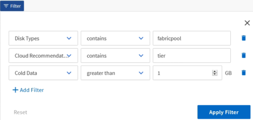

= 在 Active IQ Unified Manager 中篩選資料
:allow-uri-read: 
:icons: font
:imagesdir: ../media/

[role="lead"]
篩選資料，確保結果符合您的報告要求。篩選功能可讓您僅顯示感興趣的資料。

.步驟
. 點選篩選圖示新增篩選條件，以縮小檢視結果範圍，然後點選*套用篩選條件*。
+

. 為未儲存的檢視命名以儲存變更。

