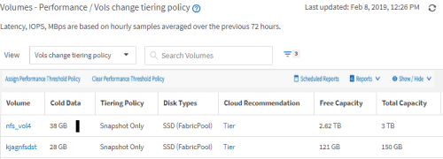

= 開始使用 Active IQ Unified Manager 產生報告
:allow-uri-read: 
:icons: font
:imagesdir: ../media/

[role="lead"]
建立自訂報告範例，以體驗探索檢視和排程報告。此快速入門報告會尋找您可能想要移至雲端分層的 Volume 清單，因為其中有相當數量的非作用中（冷）資料。您將開啟「效能：所有 Volume」檢視，使用篩選器和欄來自訂檢視，將自訂檢視儲存為報告，並排程報告每週共享一次。

.開始之前
* 您必須擁有應用程式系統管理員或儲存系統管理員角色。
* 您必須設定 FabricPool 集合體，並且在這些集合體上必須有 Volume。

請依照以下步驟操作：

* 開啟預設檢視
* 透過篩選和排序資料來自訂欄
* 儲存檢視
* 排程產生自訂檢視的報告

.步驟
. 在左側導覽窗格中，按一下 *儲存設備* > *Volume*。
. 在「檢視」功能表中，選擇 *效能* > *所有 Volume*。
. 按一下 *顯示/隱藏* 以確保 "`磁碟類型`" 欄顯示在檢視中。
+
image::../media/show_hide_3.png[一張顯示「顯示/隱藏」選單下拉清單的 UI 快照。]

+
新增或移除其他欄，以建立包含對報告至關重要的欄位的檢視。

. 將「`Disk Types`」欄拖曳至「`Cloud Recommendation`」欄旁邊。
. 點選篩選圖示新增以下三個篩選條件，然後點選 *套用篩選條件*：
+
** 磁碟類型包含 FabricPool
** Cloud Recommendation 包含分層
** 冷資料大於 10 GB image:../media/filter_cold_data_2.png["一張 UI 快照，展示如何從篩選選項中套用篩選條件。"]

+
請注意，每個篩選條件之間都使用邏輯 AND 連接，因此傳回的所有 Volume 都必須滿足所有條件。最多可以新增五個篩選條件。

. 按一下「冷資料」欄的頂部，對結果進行排序，使包含最多冷資料的 Volume 顯示在檢視的頂部。
. 當檢視為自訂的時，檢視名稱為「未儲存的檢視」。為檢視命名以反映檢視顯示的內容，例如 "`Vols change tiering policy`"。完成後，按一下核取記號或按 *Enter* 鍵以使用新名稱儲存檢視。
+

. 將報告下載為 *CSV*、*Excel* 或 *PDF* 檔案，以便在排程或共享之前檢視輸出。
+
使用已安裝的應用程式（例如 Microsoft Excel（CSV 或 Excel）或 Adobe Acrobat（PDF））開啟檔案，或儲存檔案。

+
[NOTE]
====
您可以將檢視下載為 Excel 檔案，然後使用複雜的篩選器、排序、樞紐分析表或圖表進一步自訂報告。在 Excel 中開啟該檔案後，使用進階功能自訂您的報告。滿意後，上傳 Excel 檔案。執行報告時，此檔案及其自訂設定將套用至檢視。

====
+
如需有關使用 Excel 自訂報告的詳細資訊，請參閱 _Microsoft Excel 報告範例_。

. 按一下庫存頁面上的 *排程報告* 按鈕。所有與該物件（在本例中為 Volume）相關的排程報告都會顯示在清單中。
+
image::../media/scheduled_reports_3.gif[一張顯示與該物件相關的所有排程報告的 UI 快照。]

. 按一下 *新增排程* 以在「報告排程」頁面中新增一列，以便您定義新報告的排程特性。
. 輸入報告名稱並填寫其他報告欄位，然後按一下列尾的勾號（image:../media/blue_check.gif[""]）。
+
報告會立即作為測試傳送。之後，報告會產生並依指定的頻率透過電子郵件傳送給列出的收件者。

+
以下範例報告為 CSV 格式：

+
image::../media/csv_sample_report.gif[一張顯示 CSV 格式範例報告的 UI 快照。]

+
以下範例報告為 PDF 格式：

+
image::../media/pdf_sample_report.gif[顯示 PDF 格式範例報告的 UI 快照。]

根據報告中顯示的結果，您可能需要使用 ONTAP System Manager 或 ONTAP CLI 將某些 Volume 的分層原則變更為 "`auto`" 或 "`all`"，以便將更多冷資料卸載到雲端分層。
