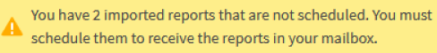
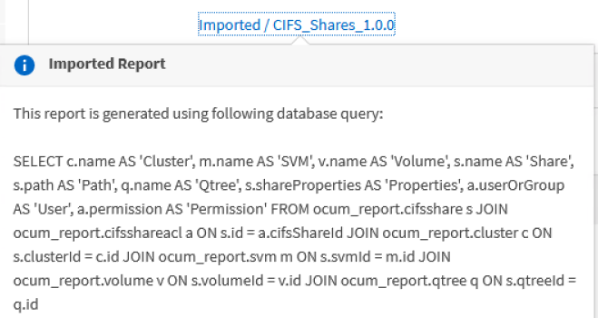

= 在 Active IQ Unified Manager 中排程匯入的 .rptdesign 報告
:allow-uri-read: 
:icons: font
:imagesdir: ../media/

[role="lead"]
您可以排程在較早版本的 Unified Manager 中建立與匯入的現有報告。

排程匯入的報告需要下列項目：

* 在早期 Unified Manager 版本中匯入的 BIRT 設計 .rptdesign 檔案報告
* 適用於升級至 Unified Manager 9.6 GA 或更高版本時

升級至 Unified Manager 9.6 GA 或更高版本後，「報告排程」頁面會列出已匯入的報告。您可以編輯這些報告的排程，指定收件者電子郵件地址、頻率和格式（PDF 或 CSV）。否則，您將無法在 Unified Manager 介面中編輯或檢視這些報告。

.步驟
. 開啟「報告排程」頁面。如果您已匯入報告，則會顯示一則訊息。
+

. 按一下 *檢視* 名稱以顯示用於產生報告的 SQL 查詢。
+

. 按一下更多圖示 image:../media/more_icon.gif[""]，按一下 *編輯*，定義報告排程詳細資料，並儲存報告。
+
[NOTE]
====
您也可以透過「更多」圖示刪除任何不需要的報告image:../media/more_icon.gif[""]。

====

