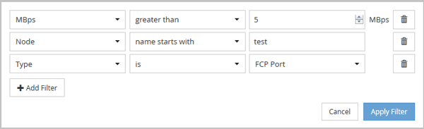

= 在 Active IQ Unified Manager 中篩選庫存頁面內容
:allow-uri-read: 
:icons: font
:imagesdir: ../media/

[role="lead"]
您可以在 Unified Manager 中篩選庫存頁面資料，以便根據特定條件快速找到資料。您可以使用篩選功能縮小 Unified Manager 頁面的內容範圍，僅顯示您感興趣的結果。這提供了一種非常有效率的方法，可以只顯示您感興趣的資料。

使用 *篩選* 根據您的喜好自訂網格檢視。可用的篩選選項取決於網格中顯示的物件類型。如果目前套用了篩選器，則已套用的篩選器數量會顯示在「篩選」按鈕的右側。

支援三種類型的篩選參數。

|===
| 參數 | 驗證 

 a| 
字串（文字）
 a| 
運算子包括 *包含*、*以……開頭*、*以……結尾*和 *不包含*。

 a| 
數字
 a| 
營運者包括 *大於*、*小於*、*在最後* 和 *介於*。

 a| 
列舉（文字）
 a| 
營運者為 *is* 和 *is not*。

|===
每個篩選器都需要填寫「欄」、「營運者」和「值」欄位；可用的篩選器反映了目前頁面上可篩選的欄。最多可以套用四個篩選器。篩選結果是根據組合的篩選參數。篩選結果適用於篩選搜尋範圍內的所有頁面，而不僅是目前顯示的頁面。

您可以使用「篩選」面板新增篩選條件。

. 在頁面頂部，點選 *篩選* 按鈕。此時將顯示篩選面板。
. 點擊左側下拉清單並選擇一個物件；例如，_叢集_ 或效能計數器。
. 按一下中間的下拉式清單，然後選擇您要使用的營運者。
. 在最後一個清單中，選擇或輸入一個值以完成該物件的篩選。
. 若要新增另一個篩選條件，請點選 *+新增篩選條件*。此時會顯示額外的篩選條件欄位。請依照前面步驟中所述的程序完成此篩選條件。請注意，新增第四個篩選條件後，*+新增篩選條件* 按鈕將不再顯示。
. 按一下 *Apply Filter*。篩選選項會套用至網格，且篩選器數量會顯示在 Filter 按鈕右側。
. 使用篩選面板，按一下要移除的篩選器右側的垃圾桶圖示，即可移除個別篩選器。
. 若要移除所有篩選條件，請按一下篩選面板底部的 *重設*。

[[filtering-example]]
== 過濾範例

圖中顯示包含三個篩選器的篩選面板。當篩選器數量少於四個（最大值）時，會顯示 *+Add Filter* 按鈕。

點擊 *套用篩選器* 後，篩選面板會關閉，套用您的篩選器，並顯示已套用的篩選器數量（image:../media/opm_filters_applied.gif[""]）。
